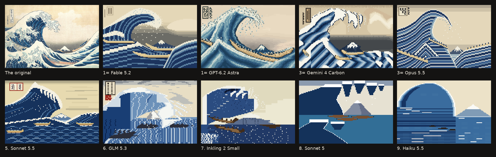

# DaliBench: The Persistence of Memory

Can language models paint famous artworks from memory, using only text?

**[See every picture, the results, and rank a set yourself](https://le-big-mac.github.io/dalibench/)**



## How it works

1. We give the model only the title, artist, and date of the painting, as text.
2. It selects its own colour palette, one character per colour defined by RGB values, and then types the picture row by row, one character per pixel, by calling a tool. The tool only checks that each row has the right length.
3. We repeat this at 16, 32, 64, and 128 cells wide, starting from scratch each time.
4. A judge sees the original and every finished picture of it, unlabelled and shuffled, and ranks them: two judges, three times each.

The exact prompts, the judging protocol, and the scoring are in [docs/method.md](docs/method.md).

## Results

Sixteen paintings, eight models at their highest reasoning effort, one attempt per painting and size. We choose 128 as the headline number, as it's where the capability difference between models is most visible.

| | Model | Rank score at 128 wide |
| --- | --- | --- |
| 1 | Fable 5.2 | 0.87 |
| 2 | GPT-6.2 Astra | 0.85 |
| 3 | Gemini 4 Carbon | 0.64 |
| 4 | Opus 5.5 | 0.56 |
| 5 | Fable 5 | 0.50 |
| 6 | Sonnet 5.5 | 0.37 |
| 7 | Haiku 5.5 | 0.09 |
| 8 | Sonnet 5 | 0.09 |

Rank score: how often a model's pictures beat the others at this size (0 never, 1 always). The top two are not separated at this size, and nor are the bottom two. The lead changes with the size: Gemini 4 Carbon is ahead at 16 wide, and GPT-6.2 Astra at 32 and 64. The other sizes, the cost and time per picture, and the pictures themselves are on [the site](https://le-big-mac.github.io/dalibench/); the run's transcripts and judgements are not in this repository.

Four things to keep in mind:

- Both judges are Claude models that also compete (Fable 5.2 and Opus 5.5).
- Each model made one attempt per painting and size, so the variation between attempts is not measured.
- A rank score is a standing against the other models in the same run, not an absolute measure.
- At 128 wide the provider blocked eleven attempts by Claude models, which have no picture. Those models are scored on fewer than sixteen paintings there, and a missing picture is not counted as a loss.

## Install

Python 3.10 or later.

```sh
git clone https://github.com/le-big-mac/dalibench && cd dalibench
python3 -m venv .venv && source .venv/bin/activate
pip install -e ".[all,dev]"
```

The package and its command are called `paintbench`. The core needs only Pillow and PyYAML; each provider's SDK is an extra (`.[anthropic]`, `.[openai]`, `.[google]`).

## Try it offline

The whole pipeline with scripted stand-ins for the models and the judge: no network, no key, no cost.

```sh
paintbench attempt --config configs/offline-demo.yaml
paintbench judge   --run offline-demo
paintbench score   --run offline-demo
paintbench report  --run offline-demo     # writes runs/offline-demo/report/index.html
```

## Run it

`configs/dalibench.yaml` is the full run. It reads the API keys from `ANTHROPIC_API_KEY`, `OPENAI_API_KEY`, and `GEMINI_API_KEY`.

```sh
python scripts/fetch_originals.py persistence-of-memory   # the one reference image the repository does not carry
paintbench estimate --config configs/dalibench.yaml       # counts the calls and puts a rough cost on them
paintbench attempt  --config configs/dalibench.yaml       # shows the estimate and asks before it spends
paintbench judge    --run dalibench
paintbench score    --run dalibench
paintbench report   --run dalibench
```

The full run is expensive: the attempts of the published one come to well over a thousand dollars at list price, most of it thinking tokens, and the estimate runs low for models at their highest effort. To start small, cut the `models`, `paintings`, and `widths` lists in a copy of the config, or name what to run:

```sh
paintbench attempt --config configs/dalibench.yaml --only "great-wave/32/haiku-5.5/*"
```

Everything is resumable: work already on disk is not repeated. `attempt` and `judge` are the only commands that call a model.

| Command | What it does |
| --- | --- |
| `estimate` | Counts the calls a config would make and prints an approximate cost |
| `attempt` | Runs the models and saves transcripts and pictures |
| `judge` | Runs the judges on the saved pictures |
| `human-sheet` | Builds a blind sheet for a person to rank, and records their ranking |
| `score` | Computes the rank scores and the agreement between judges, and with people |
| `report` | Builds an HTML report of the run |
| `render` | Turns typed pictures into PNGs |
| `import` | Brings pictures typed outside the harness into a run |
| `reference` | Rebuilds a painting's reference image from the museum's photograph |

## Add a model or a painting

A run is one config file; `configs/example.yaml` shows every key. To add a model, copy an entry under `models`. There are adapters for Anthropic, OpenAI (the Responses API), Google, and any OpenAI-compatible endpoint (the last has not been run against a live API).

To add a painting, copy an existing painting's directory under `paintings/`, put the museum's photograph in it as `original.jpg`, and edit `meta.yaml` (the wording given to the model, the crop, and the source). Then run `paintbench reference <slug>`, replace the copied hashes, sizes, and grid heights in `meta.yaml` with the ones it prints, and name the painting in a config.

## Reference images

Each painting's directory holds the image the judges see (`reference.png`, longest side 1,024 pixels) and a `meta.yaml` with its source, licence, and credit line. The Persistence of Memory is in copyright, so its image is not in the repository: `scripts/fetch_originals.py` downloads it from the museum. The same script fetches the full-size photographs of the other paintings, which are only needed to rebuild a reference image.

Three of the photographs (The Fighting Temeraire, Sunflowers, and Wanderer above the Sea of Fog) are used on Wikimedia Commons' position that a faithful photograph of a public-domain painting carries no copyright of its own; the museums that took them say otherwise. Their records say so.

## Tests

```sh
python -m pytest
```

About 130 tests, which run in a few seconds. None of them touches the network.

## Related work

- [Pelicans on a bicycle](https://simonwillison.net/2024/Oct/25/pelicans-on-a-bicycle/), Simon Willison: an SVG of a pelican riding a bicycle.
- [Pixel Art Bench](https://www.emergentmind.com/pixel-art-bench), Emergent Mind: pixel art of seven subjects on a 24 by 24 grid, the Mona Lisa among them.
- [PixelBench](https://arxiv.org/abs/2611.02540), Zhang et al.: a palette and a grid of indices for a named object, 16 to 64 pixels wide.
- [PixelBench](https://arxiv.org/abs/2611.20628), Hong et al.: pixel art drawn by writing programs, up to 256 pixels wide.
- [How Does A Blind Model See The Earth?](https://outsidetext.substack.com/p/how-does-a-blind-model-see-the-earth), henry: a world map, from asking point by point whether it is land or water.

## Licence

The code is under the MIT License. The reference images under `paintings/` are not: each keeps the terms of its source, recorded in its `meta.yaml`.
